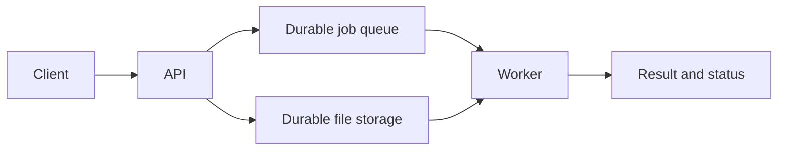

# Decked

**Practice system design trade-offs in five minutes a day.**

[Try 8 questions — no account required](https://decked.pages.dev) · [Ten sample challenges](docs/marketing/challenges.md)

Preparing for a system design interview? Decked gives you short architecture scenarios, visual explanations of the alternatives, and adaptive review of your weakest topics. Use it alongside longer design exercises and mock interviews.

### A 30-second walkthrough

1. Start an eight-question session.
2. Read a scenario and choose the approach that fits its constraints.
3. Compare the architecture diagrams and read why the alternatives fail.
4. Finish the session, review mistakes, and return for spaced review.

### Try this decision

An uploaded file takes 20 seconds to process. Your API must acknowledge acceptance within 300 ms, and accepted work must survive restarts.

- **A:** Process it inside the API request.
- **B:** Store it durably, enqueue a job, and process it with a worker.
- **C:** Return success and start an in-memory background task.

**B fits:** durable acceptance decouples response time from processing. A misses the latency budget; C can lose work on restart. Retried jobs need idempotent processing.



### What you get

- Short decision drills with explanations and architecture diagrams.
- Adaptive topic selection and spaced review.
- A Concept Lab for exploring explanations and bounded experiments.
- Browser-based practice with offline fallback; no account required to start.

Cards are AI-assisted and can contain mistakes. Report confusing explanations through the app’s feedback control. Drills train individual decisions; they do not establish readiness for a complete interview.

[Launch and recruitment kit](docs/marketing/launch-kit.md)

---

## Product and technical reference

A flash card app that trains system design intuition. Each card presents a
**mini system design problem between two nodes** (e.g. "Client wants to send
1,000 events/s to a downstream service") with a few concrete options the user
selects from. The app builds a **user profile of strengths, weaknesses, and
gaps**, then systematically surfaces cards that target the user's weakest areas
to maximize learning.

## Problem

System design interviews and real-world architecture decisions require
recognizing recurring patterns (queues vs streams, sync vs async, cache
placement, sharding strategies, consensus protocols) quickly and correctly.
Existing resources (DDIA, blogs, YouTube) are passive: you read or watch but
you don't *practice*. Spaced repetition systems like Anki work for facts but
not for *decisions between trade-offs*. This app fills that gap: active,
decision-based practice with adaptive difficulty.

## Target users

- Engineers preparing for system design interviews (FAANG, startups)
- Junior+mid engineers who want to build architectural intuition
- Senior engineers brushing up on patterns they don't use day-to-day

## Core features (v1)

**Cards:**
- Each card describes a scenario and constraint: e.g. *"A mobile app uploads
  photos to the cloud. Users see a gallery of their recent 50 photos instantly.
  The backend must process each photo into 3 sizes."*
- A few nodes are named (client, API gateway, worker, object store, database)
- The user selects from 2-4 plausible wiring options (e.g. "sync resize in the
  API process" vs "async worker queue + object store callback")
- After answering, the card shows WHY the better option wins (the trade-offs)
- Answer options are shuffled for each card view while their authored letters
  stay attached, so keyboard positions cannot reveal the answer and explanation
  references remain accurate
- Each option lists the topics needed to evaluate that approach; the card's
  Know First list aggregates the prerequisites from every option
- A navigable topic map shows prerequisites, dependent topics, mastery, and
  focused practice actions without locking advanced content
- Every screen is URL-addressable via hash routes (`#/search`, `#/concepts`,
  `#/concept/<concept>`, `#/design-decisions`, `#/stats`, ...), so any page can
  be bookmarked, shared, or deep-linked and survives refresh and back/forward
  navigation. Legacy `#/wiki` and `#/sandbox` links remain supported as Concept
  Lab aliases.

**User profile:**
- Tracked per topic across a 29-topic catalog: API design, DNS, caching,
  queues, databases, security, load balancing, storage, messaging, rate
  limiting, observability, real-time, consensus, client-server, IP address,
  HTTP & HTTPS, reverse proxy, CDN, REST API, GraphQL, WebSockets, webhooks,
  API gateway, SQL vs NoSQL, sharding, replication, denormalization,
  consistent hashing, and blob storage
- Strength per topic: accuracy × recency-weighted
- Systematic coverage: the app knows which topics you haven't seen enough of
  and surfaces cards from those areas

**Adaptive deck:**
- Cards due for review on a spaced repetition schedule (1d, 3d, 7d, 14d)
- When picking a new card: weight by (1 - topic strength) × (coverage gap)
- Standard session: exactly 8 distinct cards drawn from the full 29-topic
  catalog; Quick Review requests 15
- Progressive difficulty ramp: never-studied topics start at difficulty 1, and
  within each session fresh cards play easy → hard (due reviews keep their
  first position), so users start with lower-difficulty problems and move up
  as mastery grows
- Five visible challenge levels — Foundations, Trade-offs, Pressure test,
  Failure modes, and Architecture judgment — make the next milestone clear.
  Fresh-card difficulty is capped at the earned level after real practice;
  scheduled reviews and retries remain available.
- Prerequisite-first ordering: within a difficulty tier, foundational topics
  are served before the topics that build on them
- Anki-style mix ratio: fresh cards are capped at half the session so
  scheduled reviews keep their slots and new content never dominates
- Desirable-difficulty pacing: recent answers (last 10 per topic) steer each
  topic's difficulty toward the 60-80% accuracy band
- Due reviews are ordered by predicted-recall risk (FSRS R = e^(-t/S)), not
  recency alone
- Delayed repetition: a card answered wrong returns at the end of the session
  for an immediate second chance (once per card per session)
- Session end shows a "Review your mistakes" list with the correct answer and
  explanation for every card answered wrong
- Architecture diagrams: every card carries a directed flow graph (`flows`
  with `from`/`to`/`verb`/`kind`) and each option carries a non-empty set of the
  exact wiring it implies. Cards with incomplete or invalid correct-option
  wiring are rejected from server/browser caches, custom-card fallback, saved
  profiles, and resumed sessions so they can be regenerated instead of
  reaching diagram rendering. Options without distinct wiring may inherit the
  validated correct-option graph; cards whose options collapse into one
  identical linear topology are also rejected before rendering.
  Diagrams use Mermaid flowcharts with parallel branches, callback back-edges,
  verb-labeled edges, and theme-aware colors. Immediately after an answer,
  every option's wiring is overlaid in one top-to-bottom diagram with a
  color-coded legend and a checkmark for the correct option. If Mermaid is
  unavailable or fails to render, the app shows a reload message instead of
  generating a second diagram format.

**Data model:**
```json
{
  "card": {
    "id": "cache-003",
    "scenario": "A read-heavy API returns user profiles...",
    "nodes": ["mobile app", "API server", "PostgreSQL"],
    "options": [
      {"id": "A", "label": "Add Redis between API and PG", "prerequisiteTopics": ["caching"]},
      {"id": "B", "label": "Add CDN in front of API", "prerequisiteTopics": ["caching", "dns"]},
      {"id": "C", "label": "Add read replicas to PG", "prerequisiteTopics": ["databases"]}
    ],
    "correct": "A",
    "explanation": "Redis ... because ...",
    "topic": "caching",
    "prerequisiteTopics": ["api-design"],
    "difficulty": 3
  },
  "profile": {
    "user_id": "...",
    "topic_scores": {"caching": 0.75, "queues": 0.3, ...},
    "card_history": [
      {"card_id": "cache-003", "correct": true, "attempted_at": "..."}
    ]
  }
}
```

**Concept Wiki:**
- The full Wiki destination opens the shared Concept Lab with the Wiki
  explanation on one side and the experiment on the other; the topic side
  panel remains clickable for every concept
- Concept Lab opens with every bundled concept grouped by area (API Basics,
  Networking, Databases, Caching, Messaging & Queues, Data Processing,
  Distributed Systems, Reliability & Scaling, Storage, and Security &
  Observability); selecting one opens a child page at `#/concept/<concept>`
  with both views together
- Know First links still provide a quick inline Wiki explanation without
  interrupting the current card
- Entries are bundled with the app as `js/wiki.js` in a fixed schema
  (`topic`, `title`, `summary`, `why_it_matters`, `key_points`,
  `common_pitfalls`, `related_topics`) and shown inline on cards via the Know
  First links and a modal

**Concept Sandbox:**
- A deterministic, offline `#/sandbox` entry point opens the same Concept Lab;
  learners predict, run, and explain a node while its Wiki context stays
  visible alongside it.
- The reviewed node-model catalog includes the original Redis-like cache,
  queue + worker, and relational database, plus eighteen interview patterns:
  social feed, realtime messaging, video pipeline, geospatial dispatch, URL
  shortener, rate limiter, object storage/sync, notification fanout, search
  autocomplete, distributed key-value storage, consistent hashing, load
  balancer, API gateway, reverse proxy, CDN, WebSockets, database sharding,
  and replication. Each model declares its own controls, situations, outputs,
  and teaching assumptions in `js/sandbox.js`.
- The ten additions were prioritized by recurrence across [Hello Interview's
  guided-practice catalog](https://www.hellointerview.com/practice/system-design),
  [SWE Helper's common-question list](https://swehelper.com/blog/common-questions/),
  and [LLDCanvas's most-asked list](https://www.lldcanvas.in/blog/most-asked-system-design-questions).
  Product aliases are collapsed into reusable families; this is a
  prioritization proxy, not a claim about interview odds.
- Results show model-specific derived metrics such as cache misses and backend
  traffic, queue backlog and drops, or database connection pressure and
  replica lag. The lab is explicitly not a production benchmark or capacity
  recommendation.
- The result panel draws a model-specific, responsive simulation trace with a
  three-stage path and observed branches, so learners can see where work went
  instead of reading metrics in isolation. The pre-run state shows the same
  path as a compact preview.
- Each generated experiment names the learner problem it is testing: keep up
  with demand, protect user-visible latency, avoid pressure amplification, or
  find concentrated partition/key pressure. After a run, fixed simulator
  signals provide evidence for that question rather than only a generic status
  label.

**Generated content and quotas:**
- Cards are generated on demand with AI, cached for reuse, and supported by an
  offline seed-card fallback.
- The default free tier is 10 freshly generated cards and 10 wiki entries per
  UTC day, plus 3 fresh generated Sandbox definitions. Pro removes those limits,
  and cache hits do not consume quota.
- When a learner opens a full Concept Lab for a Wiki topic without a reviewed
  node mapping, the app can generate a labeled `bounded-pressure` experiment.
  The provider supplies only escaped copy and bounded situation values; the
  browser owns the simulator, formulas, limits, and trace. Generated
  definitions are cached in `WIKI_CACHE` under `sandbox:v1:<topic>` and in
  local storage for offline replay. A failed generation leaves the Wiki and
  reviewed Sandbox catalog usable.
- Bundled concepts are prewarmed asynchronously by the protected
  `POST /api/sandbox/prewarm` maintenance endpoint and the scheduled/manual
  `sandbox-prewarm.yml` workflow. The workflow derives topics from `js/wiki.js`,
  sends one topic, waits for its result, and only then sends the next; bulk
  provider concurrency is intentionally one. A newly lazy-generated Wiki entry
  schedules the same Sandbox fill in the background.

## Concept wiki

Every option lists prerequisite topics, and the card's Know First list
aggregates them. Each concept name is a clickable wiki link that opens a wiki
side panel/modal with a concise system-design explainer (title, summary, key
points, common pitfalls, and related topics) for that concept.

- A committed snapshot of **96 wiki entries** ships in `js/wiki.js` and loads
  with the app like the card data, so the most common concepts work instantly
  and offline.
- Concepts missing from the snapshot are **lazily generated on demand** by
  `functions/api/wiki.js` (`GET /api/wiki?topic=<kebab-case-concept>`) using
  the same OpenCode Go provider and schema as the card generator. Results are
  cached in the `WIKI_CACHE` Cloudflare KV binding with a **30-day TTL**
  (2592000 s) and merged into the in-app snapshot, so each concept is
  generated at most once per cache window.
- The snapshot can be regenerated in bulk with
  `OPENCODE_API_KEY=... node scripts/generate-wiki.mjs [--limit N]`, which
  walks the topic universe derived from the card catalog, every card/option
  prerequisite, and the production card cache. Generation runs **3-at-a-time
  with one retry per topic** and every entry is validated against the wiki
  schema before it is written.
- `bash check.sh` already syntax-checks `js/wiki.js`,
  `functions/api/wiki.js`, `functions/api/sandbox.js`, and
  `scripts/generate-wiki.mjs`, and runs the Wiki and generated-Sandbox
  contract/API tests.

The wiki UI — the sidebar index and the link affordance on Know First topics
in card question headers — lives in `js/app.js`. The Concept Wiki and Sandbox
now share one Concept Lab screen: the Wiki explains the idea on the left and
the deterministic experiment tests it on the right (stacked in that order on
narrow screens). The legacy `#/wiki/<topic>` and `#/sandbox` links both open
this same surface; changing a concept keeps the visible experiment state,
while explicitly changing the node resets that node to its baseline.

The product contract and implementation verification path for the learning
ladder and sandbox live in
[`PRDs/flashcard-learning-lab-progression.md`](../PRDs/flashcard-learning-lab-progression.md)
and its [implementation plan](../PRDs/flashcard-learning-lab-progression-plan.md).

## Suggested tech stack

- **Backend:** Python (FastAPI) + PostgreSQL + SQLAlchemy
- **Frontend:** React (or plain HTML/CSS/JS PWA) — mobile-first
- **Auth:** optional / email magic link for MVP
- **Deck algorithm:** custom spaced repetition (FSRS-inspired or SM-2 variant)
  adapted for multi-option decisions rather than binary recall
- **AI generation:** cards are generated on demand, with cached results reused
  and bundled seed cards available as an offline fallback

## Design Decisions

This section records the major architecture choices behind the current
implementation. The "Suggested tech stack" above is the original seed sketch;
the decisions below describe what was actually built and why. Each entry is a
decision matrix comparing the viable options across the criteria that matter
for this product, followed by the decision made and its rationale. They are
ordered by dependency: the data-store choice drives several downstream choices,
so it comes first.

### 1. Data store — SQL vs NoSQL (key-value)

**Question.** Where should generated content, learner profiles, and cached wiki
entries live?

The app is read-heavy (a card or profile is read far more often than it is
written), writes are infrequent and user-scoped, and the payloads are
self-contained JSON blobs that are fetched by key and never joined across
records.

| Criterion | SQL (PostgreSQL) | NoSQL document (MongoDB) | NoSQL key-value (Cloudflare KV) |
| --- | --- | --- | --- |
| Read latency at the edge | Weak (origin round-trip) | Weak (origin round-trip) | Strong (edge-replicated) |
| Schema flexibility | Weak (migrations) | Good (flexible docs) | Strong (opaque JSON values) |
| Cross-record joins | Strong | Fair | Weak (not supported) |
| Write-volume fit | Overkill | Overkill | Well matched (low) |
| Operational cost / ops | High (server, backups) | High | Minimal (managed) |
| Time-to-live expiry | Needs cron/jobs | Needs TTL index | Built in |
| Offline first-load path | Needs a live API | Needs a live API | Pairs with bundled JSON |

**Decision:** NoSQL key-value (Cloudflare KV) for generated cards (`CARD_CACHE`),
learner profiles (`profile:v1:`), wiki entries (`WIKI_CACHE`), and sandbox
recipes (`sandbox:v1:`); the seed card catalog and the 96-entry wiki snapshot
ship as static JSON inside the PWA bundle.

**Rationale.** The access pattern is keyed reads of self-contained JSON blobs
with no relational queries, which is exactly KV's sweet spot. Bundling seed
content as static JSON removes the database from the critical first-load path
and keeps the app usable offline. A relational engine would add migrations,
server operations, and origin latency for features the app never uses.

### 2. Compute — serverless edge functions vs self-hosted application server

**Question.** Where does the small amount of server logic (card/wiki generation,
profile sync, sandbox prewarm) actually run?

| Criterion | Self-hosted server (FastAPI on a VPS) | Containerized service | Serverless edge (Cloudflare Pages Functions) |
| --- | --- | --- | --- |
| Global latency | Weak (one region) | Weak (one region) | Strong (edge network) |
| Ops / patching burden | High | Medium | None (managed) |
| Cost at low/idle traffic | Fixed, wasted | Fixed, wasted | Pay per request |
| Cold starts / scaling | Manual | Manual | Automatic |
| Long-running generation calls | Strong | Strong | Fair (CPU-time limits) |
| Vendor lock-in | None | Low | High |

**Decision:** Serverless edge functions on Cloudflare Pages, with the
long-running model call isolated to a single function invoked per request.

**Rationale.** The server surface is tiny — a handful of endpoints that call an
external model, validate the result, and cache it. Serverless removes patching
and scaling entirely, and edge placement puts the endpoints close to users
worldwide. The main risk, CPU-time limits, is avoided because generation is
I/O-bound (waiting on the provider), not compute-bound.

### 3. Frontend delivery — static PWA vs server-rendered vs native app

**Question.** How is the product delivered to the learner's device?

| Criterion | Server-rendered (SSR/MPA) | Static SPA + PWA | Native app (iOS/Android) |
| --- | --- | --- | --- |
| Offline / installable | Weak | Strong | Strong |
| First-load speed | Fair (server work) | Strong (CDN-cached) | Strong (installed) |
| App-store gate | None | None | Required |
| Build/CI complexity | Medium | Low | High (two platforms) |
| Reach (one codebase) | Strong | Strong | Weak (separate builds) |
| Push / device APIs | Weak | Fair (service worker) | Strong |

**Decision:** A static, installable PWA served from a CDN (Cloudflare Pages),
written in vanilla JavaScript with a service worker.

**Rationale.** The experience is one-card-at-a-time and fully client-driven
once the deck is loaded, so there is no server rendering to do. A PWA gives
native-like installability and offline use without the app-store gate or the
cost of maintaining two platform codebases.

### 4. Client framework — vanilla JavaScript vs a frontend framework

**Question.** Should the PWA be built on a framework (React/Svelte/Vue) or plain
JavaScript?

| Criterion | Vanilla JS | React/Vue/Svelte |
| --- | --- | --- |
| Dependency / bundle size | Strong (minimal) | Weak (larger) |
| Build step required | Weak (served directly) | Strong (bundler) |
| Control over SW/routing | Strong | Fair (abstracted) |
| Hiring / ecosystem familiarity | Weak | Strong |
| Long-term refactoring ergonomics | Weak | Strong |
| Suitability for this UI (a few screens) | Strong | Overkill |

**Decision:** Vanilla JavaScript with hash-based routing and a hand-rolled
service worker.

**Rationale.** The surface is a small number of screens (dashboard, card,
concept lab, stats) with modest state. Shipping plain JavaScript means the app
is served directly as static assets with no build step, keeping CI simple and
the bundle tiny, while retaining full control over the service worker and
offline caching that a PWA depends on.

### 5. Profile state — client-side vs server-side vs hybrid sync

**Question.** Where does the learner's progress live, and how does it survive
device changes?

| Criterion | Client-only (localStorage) | Server-only (DB) | Hybrid (local + sync) |
| --- | --- | --- | --- |
| Offline / instant UI | Strong | Weak | Strong |
| Cross-device continuity | Weak | Strong | Strong |
| Privacy / data ownership | Strong | Weak | Fair |
| Conflict handling | None needed | None (single source) | Needed (timestamps) |
| Resilience to server outage | Strong | Weak | Strong |

**Decision:** Hybrid — the browser's local copy is the source of truth for
immediate rendering and offline use, and changes synchronize asynchronously to
Cloudflare KV under `profile:v1:<identity>`; signed-in profiles use the verified
Supabase subject, anonymous profiles use the device id.

**Rationale.** Local-first storage gives instant, offline-capable UI, while the
KV mirror adds cross-device continuity. Because profiles are single-user, the
only conflict is "two devices edited while apart," which is resolved by the
newer-timestamp-wins rule the README already documents.

### 6. Content generation — build-time vs runtime vs hybrid

**Question.** When are cards and wiki entries produced — ahead of time, on
demand, or both?

| Criterion | Build-time only | Runtime only | Hybrid (snapshot + lazy) |
| --- | --- | --- | --- |
| First-load / offline coverage | Strong | Weak | Strong |
| Freshness / long tail | Weak (fixed catalog) | Strong | Strong |
| Model cost control | Strong (bounded) | Weak (unbounded) | Strong (quota + cache) |
| Latency for new content | Instant | Depends on generation | Instant (cached) |
| Content breadth | Weak | Strong | Strong |

**Decision:** Hybrid — a committed snapshot (seed cards and 96 wiki entries)
ships in the bundle, while unseen concepts and fresh cards are lazily generated
at runtime and cached in KV (30-day TTL for wiki, permanent pools for cards).

**Rationale.** The snapshot makes the most common content instant and offline;
lazy generation covers the long tail without pre-paying for it. Quota limits
(10 fresh cards + 10 wiki entries per UTC day) and cache reuse bound model cost,
so cache hits never consume quota.

### 7. Offline strategy — cache-first vs network-first

**Question.** When the network is slow or down, what should the PWA serve?

| Criterion | Cache-first | Network-first | Stale-while-revalidate |
| --- | --- | --- | --- |
| Perceived speed offline | Strong | Weak | Strong |
| Freshness of app shell | Weak (stale risk) | Strong | Strong |
| Freshness of generated content | Good (cached by key) | Strong | Fair |
| Complexity | Low | Low | Medium |

**Decision:** Network-first for same-origin application assets (so a deploy
reaches users promptly, keeping the last good response for offline), and
cache-first for generated content and the bundled snapshot (so cached cards,
wiki entries, and profiles render without a request).

**Rationale.** The app shell changes rarely and must update cleanly after a
deploy, so it is refreshed from the network. Content, in contrast, is immutable
by key and cached, so serving it cache-first is both fast and correct.

### 8. Authentication — managed identity vs roll-your-own

**Question.** How are users identified for synced profiles?

| Criterion | Roll-your-own auth | Managed identity (Supabase) |
| --- | --- | --- |
| OAuth flows / security review | Weak (build + audit) | Strong (handled) |
| Anonymous device-id path | Strong | Strong |
| Time to ship | Weak | Strong |
| Operational burden | High | Low |
| Cost | Low (DIY) | Freemium tier |

**Decision:** Supabase for verified signed-in identities, plus an anonymous
browser device-id path; both resolve to a stable identity key for the KV
profile namespace.

**Rationale.** Identity and OAuth are high-risk, low-differentiation work.
Delegating them to a managed provider removes the security review and redirect
handling burden while the anonymous path keeps the product usable without an
account.

### 9. Consistency model — strong vs eventual

**Question.** Must profile and cache writes be immediately consistent across
replicas?

| Criterion | Strong consistency | Eventual consistency |
| --- | --- | --- |
| Cross-device conflict freedom | Strong | Fair (LWW by timestamp) |
| Edge write latency | Weak (coordination) | Strong |
| Offline tolerance | Weak | Strong |
| Operational complexity | High | Low |

**Decision:** Eventual consistency, with last-writer-wins by timestamp for
profile fields and immutable cached keys for generated content.

**Rationale.** This is single-user, single-writer data with rare multi-device
races, so the coordination cost of strong consistency buys nothing. Timestamped
LWW handles the rare two-device race simply, and generated content is immutable
by key so a cached read is always consistent with itself.

### 10. Content storage — KV vs object storage vs relational

**Question.** Is key-value the right store for all content, or do larger or
relational artifacts need something else?

| Criterion | KV (Cloudflare KV) | Object storage (R2) | Relational (SQL) |
| --- | --- | --- | --- |
| Small JSON blobs by key | Strong | Overkill | Overkill |
| Large binaries / media | Weak (25 MB value cap) | Strong | Weak |
| Querying across records | Weak | Weak | Strong |
| Edge replication | Strong | Fair | Weak |
| Cost for this payload profile | Strong | Fair | High |

**Decision:** KV for small, keyed JSON blobs (cards, profiles, wiki entries,
sandbox recipes) and static JSON in the bundle for seed content; no object
store or relational engine is used because there are no large binaries and no
cross-record queries.

**Rationale.** Every stored artifact is small (well under KV's value-size cap)
and read by key, so KV is the cheapest, simplest store that meets the needs.
R2 and SQL would each solve a problem this app does not have.

### 11. Deployment topology — multi-region edge vs single-region origin

**Question.** Should the app be served from many edge locations or one origin
region?

| Criterion | Single-region origin | Multi-region edge (Cloudflare) |
| --- | --- | --- |
| Latency for global learners | Weak | Strong |
| Availability / failover | Fair | Strong |
| Operations / setup | Simple | Simple (managed) |
| Cost | Low | Low (static + edge) |

**Decision:** Multi-region edge via Cloudflare Pages + KV, with a global CDN for
static assets.

**Rationale.** The audience is global, and the payloads are static or
edge-replicated, so serving from the edge collapses round-trip latency with no
additional operational burden.

### 12. Repository structure — monorepo vs polyrepo

**Question.** Should this project live in its own repository or share the lab
monorepo?

| Criterion | Polyrepo (own repo) | Monorepo (lab subdirectory) |
| --- | --- | --- |
| Independent versioning/release | Strong | Fair |
| Shared CI / portfolio context | Weak | Strong |
| Cross-project drift visibility | Weak | Strong |
| Promotion cost (when launched) | None | A one-time split |

**Decision:** Own repository. The project incubated as a top-level subdirectory
of the mamaLab monorepo until the launch trigger fired — live at
`decked.pages.dev` with paid Pro subscriptions — and was promoted to
`vinitasher/decked` on 2026-10-10.

**Rationale.** This follows the lab's governance (AGENTS.md): projects stay in
the incubator until a concrete trigger (launch, independent versioning,
ownership, or bloat) justifies a split; the launch trigger fired first.

## Content strategy

- Seed with ~50 curated fallback cards covering 10 core topics
- Cards are 2-4 options each; one clearly correct, others capturing common
  wrong intuitions
- Explanations are the real value — not just "A is right" but "B fails
  because X, C fails because Y, A wins because Z"
- Future: community-submitted cards with review; curated packs for specific
  companies / domains

## Product values

- **Simple & easy:** one-card-at-a-time mobile UI; 3 minutes per session
- **Best user experience:** adaptive difficulty means the app never feels too
  hard or too easy — it meets the user where they are
- **Profitable:** subscription ($8/mo or $60/yr) for full deck + progress
  tracking; the free tier provides 10 freshly generated cards and 10 wiki
  entries per UTC day, while Pro removes those limits. Cache hits do not
  consume quota.
- **Community:** user-submitted cards with voting; community-ranked "best
  explanations" for each card
- **Force for good:** democratises system design education; transparent about
  the model (users can see why a card was chosen)

## Product strategy

The [LearnHub and MathPath strategic gap analysis](docs/learnhub-mathpath-gap-analysis.md)
assesses the current product against a question-centered adaptive learning
model and today's system-design interview market. It defines the recommended
position, capability gaps, evidence gates, three-year direction, metrics, and a
90-day validation plan for evolving from multiple-choice recognition into
guided architecture judgment.

## Deploy

The production site runs on Cloudflare Pages with OpenCode Go
`gpt-5.6-luna` generation and a KV-backed generated-card cache. The
`OPENCODE_API_KEY` credential is stored as a Cloudflare Pages secret. Node.js
22 or newer and an authenticated Wrangler session are required. The required
runtime is pinned in `.nvmrc`; `deploy.sh` automatically activates an
installed NVM Node 22+ runtime when the shell's default Node is older. If no
compatible runtime is installed, run `nvm install 22` once. Deploy from this
directory:

Generation tries `gpt-5.6-luna` first and uses `deepseek-v4-flash` as its
OpenCode Go fallback when the primary attempt fails validation or the provider
is unavailable. Further retries remain on the fallback model.
Each generation attempt designates a uniformly selected correct letter from
A-D, and model output is rejected unless it follows that prompt contract.

Generated cards are stored permanently in Cloudflare KV as bounded
`{"cards": [...]}` pools for each topic and difficulty. The generation endpoint
serves a cached card whose whitespace-normalized, case-insensitive scenario
fingerprint is not present in repeated `exclude` query parameters. When every
cached scenario is excluded, or when `force=1` is supplied, it generates and
appends a distinct card. Pools retain the newest 20 distinct scenarios; legacy
single-card values migrate to one-card pools when read. Responses include
`cached`, `card`, `poolSize`, and `poolLimit` without exposing the other cards.
At most 100 valid exclusion fingerprints are considered per request.
Learner profile progress is stored in the existing `CARD_CACHE` Cloudflare KV
namespace under `profile:v1:<identity>` and is served through
`GET/PUT /api/profile`. Signed-in profiles use the verified Supabase subject;
anonymous profiles use the browser's device id. The browser still keeps a
local copy for immediate rendering and offline use, then synchronizes changes
asynchronously. Existing local profiles migrate on the first successful
profile fetch, and newer local changes win over an older remote timestamp.
SRS reviews and card snapshots (including diagram `nodes`, `flows`, and
option wiring), topic scores, streaks, totals, and displayed-scenario ledgers
are included in the synced profile. Session resume state, bookmarks, theme/UI
preferences, and custom-card authoring remain browser-local.
Generated-card cache metrics and snapshot tooling exclude `profile:v1:` keys.

The browser mirrors the server format with bounded `{"cards": [...]}` pools
under `sdf_gen_<topic>:<difficulty>`. Existing single-card entries migrate on
read, malformed entries are ignored, and each local profile keeps its own
persisted ledger of scenario fingerprints actually displayed. Unseen cached
cards are used before a server request; prefetching does not mark a card seen.
Normal study sessions retain the existing seed-card fallback when generation is
offline, and seed cards are never stored or presented as newly generated cards.
The Regenerate control always requests forced fresh generation: it sends
`force=1` with the current card, all active session cards, and the profile-seen
ledger as repeated `exclude` parameters, bypassing local, in-memory, and seed
pools. The current session slot is replaced and marked seen only after a valid
fingerprint-distinct response arrives; HTTP errors, network failures, timeouts,
malformed or duplicate payloads, and unconfigured generation all leave the
current card and session intact and announce in an accessible live region that
fresh generation is unavailable and can be retried. The control disables itself
while generating and always restores its enabled state, and overlapping clicks
or keyboard presses never issue concurrent requests.
Session planning draws from every topic in the 13-topic catalog (never just the
seed topics) at each topic's mastery-derived target difficulty, ranked by the
existing adaptive weight with a random tie-break; sessions that need more cards
than there are topics add other unique topic+difficulty pairs. Candidates are
fetched with accumulated exclusions so duplicates are refilled rather than
silently dropped, bounded to three plan passes (count × 3 fetches). A session
only starts once its requested count is assembled: when generation and the
offline fallback cannot reach the requested count within the bound, the app
states the requested and available counts and asks the user to start the smaller
session or cancel — it never silently shows `1 / 5` for an advertised 8 or 15.
Offline seed substitution is topic-scoped, so a session slot is never padded
with a card from an unrelated topic. Prefetching and cache warming also draw
from the full catalog so the non-seed topics are not starved.
Each generated option declares prerequisite topics, and the question-level
Know First list is their deduplicated aggregate. Option prerequisites are
specific study concepts such as Cache Invalidation, Replication Lag, or Message
Ordering, not broad category or product-name tags. Legacy cached options receive
reviewed concept metadata for the seven repository-held historical cards;
their question aggregates are rebuilt and normalized cards are rewritten
permanently. Unknown browser-only custom cards retain their authored metadata
and remain in local storage.

The PWA refreshes same-origin application assets from the network after
deployment and keeps the latest successful responses for offline use. Feedback
controls remain navigable when browser progress storage is unavailable.
The question-header back control returns to the dashboard without discarding
the current session, which remains available through Resume Unfinished Session.

Unknown wiki topics are **lazily generated on first view** by
`functions/api/wiki.js` and cached in the `WIKI_CACHE` Cloudflare KV binding
for ~30 days (2592000 s), mirroring the `generate-wiki.mjs` schema and
provider settings (`gpt-5.6-luna` first, `deepseek-v4-flash` fallback,
thinking disabled). Cached entries are served without a generation call, so
each concept is generated at most once per cache window.

Full Concept Lab views also request `functions/api/sandbox.js`
(`GET /api/sandbox?topic=<kebab-case-concept>`) when no reviewed Sandbox node
is mapped to the selected Wiki concept. The endpoint validates a data-only
recipe, retries the configured provider sequence, and stores valid recipes
under the separate `sandbox:v1:` prefix. The browser registers the recipe in
the fixed bounded-pressure simulator, with exactly five situations and three
stable outcomes; it never executes provider-authored code or formulas. The
first three fresh definitions per UTC day are free, Pro is unlimited, and
server or local cache hits are free. The contract and rollout details live in
[`PRDs/generated-concept-sandbox.md`](../PRDs/generated-concept-sandbox.md) and
its [implementation plan](../PRDs/generated-concept-sandbox-plan.md).

```sh
bash check.sh
bash deploy.sh
```

`check.sh` includes a read-only audit of the committed production card
snapshot. It verifies that every option has two to four granular prerequisite
concepts and that each card's Know First list is exactly their deduplicated
union. To inspect another local fixture without contacting production KV, run
`node scripts/audit-option-prerequisites.mjs --snapshot <path>`.

The script verifies Cloudflare authentication and configured resource IDs,
stages only public PWA assets, bundles the functions under `functions/`, and
publishes the production branch to `https://decked.pages.dev`.

Cloudflare Git integration uses `bash check.sh && bash build.sh` and deploys
`.pages-dist` from the `main` branch. Pull requests receive preview
deployments.

## PWA installability

The app is installable as a Progressive Web App. To test on each platform:

**Desktop Chrome:**
Open DevTools (F12) > Application > Manifest — verify no errors. An install
icon should appear in the address bar after visiting twice, five minutes apart.

**Android Chrome:**
Visit the site, then look for the "Add to Home Screen" prompt or tap the
menu (⋮) > "Install app" / "Add to Home Screen". The installed app launches
in standalone mode with no browser UI.

**iOS Safari (iPhone):**
Tap the share button (□↑) > "Add to Home Screen". The app icon appears on
the home screen and launches in full-screen mode. `navigator.standalone` is
`true` after installation.

**Lighthouse audit:**
Chrome DevTools > Lighthouse > Progressive Web App — should score 100% on
installability checks (valid manifest, registered service worker, HTTPS,
icons at required sizes).

## Visual verification

The dashboard and study surfaces use the same responsive visual system across
desktop, phone, dark mode, and high-contrast mode. Verify the static shell with
the existing checks, then render `index.html` at 1440px and 390px widths and
inspect the dashboard, card controls, and secondary-screen surfaces.

```sh
bash check.sh
bash build.sh
chromium --headless --no-sandbox --window-size=1440,1200 \
  --screenshot=/tmp/system-design-flashcards-desktop.png index.html
chromium --headless --no-sandbox --window-size=390,1200 \
  --screenshot=/tmp/system-design-flashcards-mobile.png index.html
```

The learning ladder and Concept Sandbox are behavior changes in addition to the
shared visual system: the ladder updates from study evidence, sandbox
prediction aggregates are included in the existing local profile sync path,
and the Wiki and experiment now share one two-pane learning surface.
