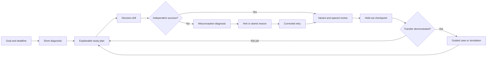

# From Flashcards to a System Design Learning Platform

## Strategic gap analysis inspired by LearnHub and MathPath

**Status:** Product strategy working document

**Research date:** 2026-08-11

**Planning horizon:** 3 years

**Scope:** System Design Flashcards (`decked.pages.dev`), not the wider mamaLab portfolio

## Executive judgment

System Design Flashcards should not become a feature-for-feature copy of
LearnHub or MathPath. It should borrow their strongest product idea: a question
is not merely an assessment at the end of teaching; it is the center of a
continuous loop of attempt, diagnosis, just-in-time teaching, correction,
practice, and demonstrated mastery.

The current product has a credible starting wedge. It offers short,
decision-based practice; adaptive topic selection; spaced review; prerequisite
links; architecture diagrams; immediate correction; delayed retries; a concept
wiki; and a low-friction PWA. These are more useful foundations than a passive
course library.

The central gap is that it currently trains **recognition of a plausible
architecture choice**, while real system design requires a learner to
**construct and defend a design under changing constraints**. A correct
multiple-choice answer is weak evidence that the learner can clarify
requirements, estimate scale, choose a data model, assemble components,
anticipate failure modes, or explain trade-offs aloud. Topic-level accuracy
also cannot reveal *why* a learner failed.

The recommended product thesis is:

> Become the adaptive practice coach that turns system design knowledge into
> observable engineering judgment, from five-minute decision drills to a
> defensible end-to-end design.

The near-term objective is not to build courses, an AI tutor, a whiteboard,
classes, community, and mock interviews at once. It is to prove a tighter
learning loop on a narrow slice of the curriculum:

1. Decompose an architecture decision into observable reasoning steps.
2. Map wrong moves to specific misconceptions.
3. Give the smallest useful hint or lesson at the point of need.
4. Retest the same skill on a new scenario, then again after a delay.
5. Show the learner one credible next action and evidence of improvement.

If this loop improves held-out performance and return behavior, it becomes the
foundation for guided cases, interview simulation, expert review, community
contributions, and a durable subscription business. If it does not, adding
more content or AI will only scale a weak learning unit.

## The strategic translation: what “similar” should mean

[LearnHub](https://learnhub.com/) describes MathPath as the first subject path
in a broader home for learning by doing. Its public product story centers the
question, offers help only when the learner needs it, breaks problem solving
into observable moves, maps wrong options to misconceptions, and connects
daily review, a mistake bank, lessons, an AI tutor, diagnostics, study plans,
and exam simulation. Its [about and vision
page](https://learnhub.com/about) also describes a compounding content loop:
AI drafts, experts review, learners practice, and usage data identifies what
people should improve next.

Those ideas translate well to system design, but the exact MathPath flow does
not. “Identify, strategy, calculate” is appropriate for mathematics. A system
design equivalent should be tested with learners, but a strong initial model is:

| Move | Learner action | Evidence captured |
|---|---|---|
| Frame | Clarify the goal, users, scope, and non-goals | Can the learner turn ambiguity into a solvable problem? |
| Quantify | Identify scale, latency, durability, consistency, cost, and growth constraints | Can the learner find the constraints that change the design? |
| Model | Define core APIs, data, and access patterns | Can the learner connect product behavior to architecture? |
| Compose | Select and connect components | Can the learner construct a coherent data flow rather than name technologies? |
| Stress | Introduce load, failure, skew, concurrency, abuse, and operational constraints | Can the learner find bottlenecks and failure modes? |
| Defend | Explain the choice, rejected alternatives, and conditions that would reverse it | Does the learner understand the trade-off or merely recognize an answer? |

This sequence should be the shared grammar across drills, lessons, guided
cases, feedback, mastery, and future interview simulations. It is more
important than reproducing MathPath's individual screens.

## Product position to pursue

### Initial customer

Focus first on **mid-level and senior software engineers preparing for a system
design interview in the next 2-8 weeks**.

This segment has:

- an urgent, measurable outcome;
- a known practice format and an external evaluation event;
- willingness to pay for confidence and targeted feedback;
- enough existing knowledge to benefit from decision drills; and
- a natural path from free daily practice to paid guided cases and simulation.

Junior engineers learning from scratch remain important, but serving them well
requires more foundational instruction. Staff-level, on-the-job architecture
judgment is a valuable later expansion, but its outcomes and evaluation
standards are less uniform. Trying to serve all three groups with the same
session will blur content depth, feedback, and positioning.

### Job to be done

> When I have a system design interview approaching, help me find the reasoning
> gaps I cannot see, practice the exact moves I am weak at, and prove that I can
> produce and defend a complete design under pressure.

### Category and wedge

The category is not “flashcard app” and not “AI-generated course.” The wedge is
**adaptive deliberate practice for architecture judgment**.

Flashcards can remain the fastest practice surface, but the name and information
architecture should not permanently constrain the product to multiple-choice
cards. A later rebrand should follow evidence that users value guided practice,
not precede it.

### Product ladder

The product should grow as a ladder of increasing transfer, with the same skill
model underneath every rung:

1. **Decision drills (2-5 minutes):** recognize constraints, choose or reject a
   pattern, predict a failure, and explain one trade-off.
2. **Guided cases (10-20 minutes):** construct a design one move at a time with
   hints, targeted lessons, and rubric feedback.
3. **Checkpoints (15-30 minutes):** solve held-out cases with reduced support to
   verify transfer and update the study plan.
4. **Interview simulations (45-60 minutes):** respond through text, diagram, and
   eventually voice while the interviewer introduces changing constraints.
5. **Professional practice (later):** incident trade-offs, design reviews,
   migration planning, cost/reliability decisions, and team calibration.

Each rung should reuse evidence from the previous one. Completing a lesson or
answering many questions must not be confused with mastery.

## What exists today

This assessment is based on the repository state on the research date, not only
the README's future intentions.

### Strong foundations to preserve

- A distinct learning thesis: practice architecture trade-offs rather than
  memorize definitions.
- A simple, mobile-friendly question loop with no required account.
- Thirteen top-level topics and a prerequisite graph.
- Per-option “know first” concepts linked to an 80-entry bundled wiki, with lazy
  generation for missing entries.
- Adaptive session planning based on topic score, coverage, recent accuracy,
  prerequisites, and target difficulty.
- Spaced review and recall-risk ordering, plus same-session retry after an error.
- Architecture flow diagrams and visual comparison of option wiring.
- Search, bookmarks, session history, topic map, statistics, streaks, goals,
  achievements, offline fallback, and session resume.
- AI-assisted card generation with validation, deduplication, caching, quotas,
  and an offline seed deck.
- Optional GitHub sign-in, Stripe entitlement plumbing, and user feedback that
  can become repository issues.
- A meaningful automated test suite around session selection, scheduling,
  billing, generation, diagrams, routing, feedback, and persistence.

### Constraints that matter strategically

- The committed fallback deck contains five cards. A checked-in snapshot of the
  production cache contains eleven cards across six topics. Runtime generation
  can expand this, but generation volume is not the same as a verified bank.
- Progress, mastery, custom cards, bookmarks, and history are local to one
  browser. Authentication currently establishes billing identity, not a durable
  learning identity.
- The learner response is one selected option plus a self-reported difficulty.
  No reasoning step, free response, diagram edit, spoken explanation, or
  clarification question is assessed.
- Feedback is a single explanation for the card. Options have prerequisites,
  but no stable misconception identifiers or option-specific corrective paths.
- “Mastery” is a topic-level heuristic based on accuracy, three unique cards,
  and two days. It is not calibrated against a held-out task or skill-level
  transfer.
- The topic map exposes prerequisites but does not create a goal-, level-, or
  deadline-specific learning plan.
- The concept wiki is reference material, not an interactive lesson with an
  attempt, scaffolded practice, or completion evidence.
- There is no product analytics event model for activation, retention, hint
  use, misconception correction, learning gain, or conversion.
- User-created cards remain local; there is no submission, expert review,
  versioning, provenance, or community quality loop.
- The dormant card-quality action in the client changes topic mastery if
  invoked. Content-quality evidence and learner-competence evidence must be
  separate domains in any future model.

These are appropriate prototype trade-offs. They become blockers only if the
product claims personalized mastery or scales paid acquisition before fixing
them.

## Reference market: copy the method, not the surface area

The product sits between interactive learning and interview preparation. Both
sets of alternatives shape user expectations.

| Reference | Current promise | What it makes table stakes | Strategic response |
|---|---|---|---|
| LearnHub / MathPath | Question-first learning, stepwise help, misconception feedback, daily review, mistake bank, diagnostics, plans, exams, tutor, teacher and curator workflows | Learning support at the moment of failure and a visible journey from attempt to mastery | Adapt the method to architecture reasoning; do not copy math, school, teacher, or multi-subject scope |
| [Hello Interview Guided Practice](https://www.hellointerview.com/practice/overview) | Stepwise system-design practice, personalized feedback, voice, AI tutor, question library, and interview-focused courses | Guided construction and realistic feedback are already in-market | Differentiate through longitudinal diagnosis, spaced micro-practice, and a transparent skill/misconception model—not “AI feedback” alone |
| [Educative's modern system design course](https://www.educative.io/courses/grokking-the-system-design-interview) | Large structured curriculum, quizzes, case studies, personalized roadmaps, and AI mock interviews | Breadth, recognized frameworks, and end-to-end cases | Avoid a content-volume race; be faster at finding and correcting a learner's specific gaps |
| [Exponent's system design course](https://www.tryexponent.com/courses/system-design-interviews) | Lessons, self-guided exercises, expert mock videos, interactive exercises, AI feedback, peers, coaches, company question data, and community | Rubrics, examples of expert performance, and human escalation | Make daily practice and evidence accumulation the wedge; later connect users to peer or expert review where it adds unique value |
| [ByteByteGo](https://bytebytego.com/) | Text-based visual modules and detailed step-by-step illustrations, backed by a very large audience | High-quality visuals and trusted explanatory content | Preserve interactive diagrams, but invest in learner action and correction rather than trying to out-publish a media brand |
| [Design Gurus](https://www.designgurus.io/) | Pattern-based courses, roadmaps, and paid mocks led by experienced interviewers | Interview frameworks, depth, and outcome credibility | Position around diagnosis and practice efficiency; validate whether users will pay for a shorter path to readiness |

The competitive opening is narrow but real: most products are strongest in one
or two of content, guided case practice, simulation, or human feedback. This
project can connect **short daily diagnosis** to **long-form transfer practice**
and retain a cumulative model of what the learner can and cannot yet do.

## Gap scorecard

Score each capability from 0 to 3:

- **0 — absent:** no working learner surface or reliable evidence.
- **1 — present but shallow:** useful prototype behavior, not enough for the
  intended outcome.
- **2 — effective:** solves the job for the initial segment with measured
  quality.
- **3 — compounding:** improves through trustworthy data, content operations,
  or network participation and is difficult to reproduce.

| Capability | Current | 12-month target | Gap and evidence needed |
|---|---:|---:|---|
| Clear interview outcome | 1 | 2 | The README names interview prep, but onboarding and sessions are generic. Capture goal, level, deadline, and target role; measure plan completion and readiness gain. |
| First-session activation | 1 | 2 | The homepage explains before demonstrating. Test “start with one problem,” then personalize after value is felt. |
| Observable reasoning process | 1 | 2 | Multiple choice reveals recognition, not construction. Capture at least three reasoning moves and test whether they predict held-out performance. |
| Skill and prerequisite model | 1 | 2 | Thirteen topics are too coarse; option prerequisite tags are not learner-state dimensions. Build a small, reviewed skill graph with prerequisite and transfer relations. |
| Misconception diagnosis | 0 | 2 | Wrong options have prose rationale but no stable misconception taxonomy. Map every distractor in the test slice to a misconception and a correction task. |
| Just-in-time scaffolding | 0 | 2 | The learner gets the full answer after committing. Add progressive hints, atomic references, and fading support; measure hint dependency and later independence. |
| Targeted corrective feedback | 1 | 2 | One explanation covers all options. Explain the learner's selected failure, why it fails under the stated constraint, and what evidence would reverse the choice. |
| Mistake recovery | 1 | 2 | Same-session retry and end summary exist. Add a persistent mistake bank grouped by misconception, with variant retries and resolved/unresolved state. |
| Adaptive scheduling | 1 | 2 | Useful heuristics exist, but selection optimizes topic accuracy and coverage rather than demonstrated skill transfer. Base scheduling on evidence quality, uncertainty, and goal. |
| Diagnostic and study plan | 0 | 2 | The topic map is static. Create a short diagnostic and an editable plan that says what to do next, why, and how readiness will be checked. |
| Interactive lessons | 0 | 1 | Wiki entries are references. Start with a few atomic lessons generated from repeated misconceptions; do not build a full course library yet. |
| Verified content corpus | 1 | 2 | Validation checks schema, not technical truth or pedagogical quality. Introduce review status, provenance, item versions, rubrics, and retirement rules. |
| Item quality feedback loop | 0 | 2 | There are no shared item statistics. Track ambiguity, option selection, reports, hints, completion, discrimination, and version-level outcomes. |
| Held-out assessment | 0 | 2 | Mastery is based on practiced items. Use unseen scenario variants and reduced-support checkpoints to measure transfer and delayed retention. |
| End-to-end guided cases | 0 | 2 | Current cards are isolated decisions. Build one narrow guided case before a broad case library. |
| Interview simulation | 0 | 1 | No dynamic interviewer, timed rubric, voice, or editable diagram. This follows proof of the reasoning model and guided case. |
| Explainable progress | 1 | 2 | Charts show activity and topic percentages but not evidence or uncertainty. Show “what you can do,” “what breaks,” “why we believe it,” and the next test. |
| Cross-device continuity | 0 | 2 | Account and learning state are disconnected. Add opt-in sync, export, deletion, and conflict rules without removing anonymous local practice. |
| Product analytics | 0 | 2 | Server generation logs are operational, not a learning funnel. Establish consented event and experiment models before growth work. |
| Community learning | 0 | 1 | Custom cards are local. Later enable solution methods, critique, and expert-reviewed contributions; avoid an unmoderated content feed. |
| Trust and safety | 1 | 2 | AI output is validated structurally and users can report issues, but truth review, provenance, change history, and claim-level correction are missing. |
| Monetization tied to outcome | 1 | 2 | Pro removes generation quotas. Paid value should become plans, guided cases, deeper diagnostics, simulations, and continuity—not merely more AI calls. |

Review this table quarterly. A score should only move when a learner-facing
capability exists **and** its success evidence is recorded. Shipping a screen is
not evidence that the gap is closed.

## The most important gaps, in priority order

### 1. A skill model precise enough to diagnose judgment

“Caching” or “databases” is not a useful diagnosis. A learner might know what a
cache is but fail to identify workload skew, choose the wrong cache boundary,
ignore invalidation, miss hot keys, or overclaim consistency. Those failures
require different correction and predict different future mistakes.

Build a thin skill graph for two domains first—recommended: **caching** and
**asynchronous processing**—because both appear frequently, expose trade-offs,
and connect to many other topics. Each skill should have:

- a stable identifier and plain-language description;
- prerequisite skills;
- observable behaviors at increasing depth;
- common misconceptions;
- representative and counterexample scenarios;
- evidence rules for introduction, practice, transfer, and mastery; and
- at least one boundary condition that reverses the default advice.

Do not ask an LLM to invent a giant taxonomy and treat it as curriculum. An
experienced engineer should review the initial graph, and learner data should
change it over time.

### 2. Guided reasoning and progressive help

The current reveal jumps from one choice to the complete explanation. Add a
“work it through” route that preserves productive struggle:

1. Ask which constraint dominates and why.
2. Ask which pattern addresses it.
3. Let the learner assemble or select the data flow.
4. Introduce a failure or changed requirement.
5. Ask the learner to defend or revise the choice.

At each move, offer escalating help:

- a prompt that redirects attention;
- a concept reminder or visual;
- a partially worked step;
- the worked step with explanation.

Support should fade as evidence improves. Research on worked examples supports
using examples and then removing guidance rather than leaving novices in
unguided problem solving; incremental presentation can also reduce cognitive
load and improve the learning experience ([Cambridge Handbook overview](https://www.cambridge.org/core/books/abs/cambridge-handbook-of-multimedia-learning/worked-example-principle-in-multimedia-learning/CDECDB094C169A37A79F589994C8F641),
[incremental worked-example study](https://doi.org/10.1024/1010-0652.23.2.129)).

### 3. Misconception-specific correction

Every wrong option should identify a stable misconception, not only a generic
failure. For example:

```text
Choice: "Add read replicas"
Misconception: treats aggregate read capacity as the only bottleneck
Missed evidence: 80% of traffic targets the same 100 objects
Correction: contrast workload skew with uniform read load
Transfer check: a new scenario where replicas are the better answer
```

This creates a more valuable learner model and a more valuable content model.
It also enables a mistake bank that tells a coherent story: “You repeatedly
solve average-load problems while missing skew,” rather than “You are 58% at
caching.”

### 4. A content system users can trust

Generative AI should accelerate drafting and variation, not be the source of
truth. MathPath's public strategy explicitly separates AI drafting from human
review. System design needs the same separation because many decisions depend
on unstated assumptions, organizational constraints, and changing technology.

Adopt these content states:

```text
draft -> automated checks -> technical review -> pedagogy review -> published
      -> observed in use -> revise/version or retire
```

Every published item should record:

- authoring source and reviewer;
- claims or references that need verification;
- intended skills and misconceptions;
- valid assumptions and ambiguity risks;
- difficulty evidence rather than only an authored number;
- version, change reason, and affected learner attempts; and
- item statistics segmented by relevant experience level.

A small verified bank is more defensible than an endless generated feed. AI can
create controlled variants only after a gold item and its invariants exist.

### 5. A diagnostic plan and credible readiness evidence

The learner should be able to state a goal such as “mid-level backend interview
in four weeks,” complete a short branching diagnostic, and receive a plan with:

- the three most consequential gaps;
- the practice mode appropriate to each gap;
- a weekly time budget;
- spaced reviews already scheduled;
- one end-to-end case per stage; and
- a checkpoint that can change the plan.

The plan must explain itself. “Practice queues next because you missed ordering
and backpressure in two distinct scenarios, and they are prerequisites for the
notification case” is useful. “AI recommends queues” is not.

Knowledge tracing is a relevant long-term discipline because it models mastery
from sequences of learning evidence; a modern overview describes state
estimation and performance prediction as its core purposes ([Knowledge Tracing:
A Survey](https://doi.org/10.1145/3569576)). The project does not need a deep
model now. It needs a clean evidence model and calibrated baselines before model
complexity is justified.

### 6. Transfer from micro-decisions to complete designs

Flashcards should remain daily practice, not the final outcome. The platform
must test whether learners can combine skills when the answer is not present.

The first guided case should be one familiar system with constrained scope, such
as a notification system or rate limiter. It should reuse the same reasoning
moves, skill identifiers, misconceptions, hints, and rubric as the drills. The
final checkpoint should use a different scenario and minimal support.

Do not begin with a freeform AI whiteboard. Start with structured inputs that
make feedback reliable: requirement selection, estimates, API/data choices,
component palette, labeled edges, bottleneck annotations, and short rationale.
Freeform diagram and voice can be added once the rubric works on structured
evidence.

### 7. Learning and product instrumentation

Before driving traffic, define a privacy-respecting event model. Minimum events
include:

- anonymous or account-scoped learner identifier;
- content and version identifier;
- presented skills and misconceptions;
- response, correctness, time, confidence, and support used;
- correction shown and follow-up response;
- delayed and held-out outcomes;
- plan recommendation and whether it was followed;
- session start, useful action, completion, and return; and
- subscription exposure and conversion without mixing billing state into
  learning evidence.

Capture only what the product can justify, disclose it plainly, provide deletion
and export, and keep an anonymous local-only mode. Cross-device sync should be
an opt-in benefit, not a forced privacy regression.

## Target learning loop



The loop deliberately returns to the plan. A dashboard should be a decision
surface—“what is the highest-value thing to do now?”—not a collection of charts
and utilities.

## Recommended data foundation

Do not rewrite the application around an elaborate platform schema immediately.
First define the contracts that new work should converge on:

| Entity | Purpose |
|---|---|
| Skill | An observable unit of system-design judgment, with prerequisites and performance levels |
| Misconception | A stable wrong model or decision rule, linked to skills and correction strategies |
| Item | A scenario or case independent of any one rendered variation |
| Item version | Exact prompt, assumptions, steps, options, rubric, explanation, provenance, and review state seen by a learner |
| Step | One reasoning move with response type, hints, worked solution, and assessed skills |
| Attempt event | Immutable evidence: response, timing, support, confidence, result, and context |
| Learner-skill state | Current estimate, uncertainty, last evidence, support dependency, and due time |
| Plan | Goal, deadline, recommended activities, rationale, status, and checkpoints |
| Review decision | Human or automated quality decision with author, reason, and affected version |

Keep content-quality feedback separate from learner-skill evidence. Keep
immutable attempts separate from derived mastery so the model can be improved
without losing history. Version items so a corrected explanation does not
silently reinterpret old attempts.

## Roadmap by evidence gate

Dates are less important than gates. Do not begin a later horizon merely because
time passed.

### Horizon 0: establish truth (0-6 weeks)

**Goal:** understand the initial user and create trustworthy baselines.

- Interview 12-15 engineers who attempted or expect a system design interview,
  segmented by level and deadline.
- Observe at least eight people using the current first session without coaching.
- Add consented funnel and learning events for first value, session completion,
  return, answer behavior, and support use.
- Define the initial skill and misconception graph for caching and asynchronous
  processing with expert review.
- Review and version 20-30 gold items or controlled variants across those skills.
- Replace generic topic percentages in the experiment with evidence statements.
- Test a problem-first landing flow against the current explanation-first flow.

**Gate:** at least 40% of qualified new users complete a first meaningful
practice loop, qualitative interviews confirm that the diagnosis names real
blind spots, and item review finds no unresolved critical correctness issues.
The activation target is a starting hypothesis, not an industry benchmark.

### Horizon 1: prove the corrective loop (6 weeks-4 months)

**Goal:** demonstrate that structured diagnosis and correction improve transfer.

- Ship guided reasoning steps and escalating hints for the two-domain slice.
- Map distractors and wrong steps to stable misconceptions.
- Add a persistent mistake bank with variant retry and resolution state.
- Add a short pre-test and unseen post-test with reduced support.
- Compare the guided loop with the existing answer-and-explanation card loop.
- Add goal, role level, deadline, and a small explainable weekly plan.
- Preserve anonymous use; offer account sync only to users who want continuity.

**Gate:** the guided cohort materially outperforms the existing loop on an unseen
scenario after a delay, with no unacceptable increase in abandonment or hint
dependence. Define “materially” and sample size before running the experiment.

### Horizon 2: prove end-to-end transfer and willingness to pay (4-9 months)

**Goal:** connect micro-practice to a complete interview-relevant outcome.

- Build one structured guided case and one held-out checkpoint.
- Create a reviewed rubric for framing, constraints, data/API modeling,
  architecture, reliability, trade-offs, and communication.
- Add an AI coach only inside the reviewed step and rubric boundaries; make
  uncertainty and escalation visible.
- Produce a readiness report based on demonstrated evidence, not activity.
- Test paid packaging around personalized plans, guided cases, deeper
  diagnostics, and continuity.
- Recruit a small expert reviewer pool and establish review turnaround and
  compensation.

**Gate:** users who complete drills show better case performance; a meaningful
share of interview-bound users pay or make an equally strong commitment; and
review cost per active learner has a plausible path to sustainable margins.

### Horizon 3: build the compounding system (9-18 months)

**Goal:** improve content and recommendations through use without weakening
trust.

- Expand the reviewed skill graph and case bank based on diagnosed demand, not
  nominal topic coverage.
- Use item statistics to prioritize ambiguity fixes and weak explanations.
- Introduce timed simulations, dynamic follow-ups, and text-first interview
  dialogue; add voice only if it changes readiness outcomes.
- Let learners compare reviewed solution methods and request expert critique.
- Add goal-specific tracks for selected levels or company styles only where
  there is sufficient evidence.
- Establish outcome follow-up after real interviews, with careful controls for
  self-reporting bias.

**Gate:** strong cohort retention during a realistic prep window, repeatable
paid acquisition or organic referral, improving item quality over versions, and
readiness measures that correlate with independent rubric scores or interview
outcomes.

### Horizon 4: expand the mission (18-36 months)

**Goal:** become the continuing practice system for architecture judgment, not
only a short-lived interview subscription.

Potential expansions, each requiring a separate evidence case:

- staff-level design reviews and architecture decision records;
- production incident and migration simulations;
- team skill calibration and manager-assigned practice;
- verified community-authored scenarios and alternate solution methods;
- domain tracks such as data infrastructure, ML systems, security, or frontend
  architecture; and
- peer practice or a marketplace for expert mock interviews.

Do not expand to unrelated academic subjects. LearnHub's umbrella strategy is
appropriate for its mission; this product's defensibility comes from depth in
engineering judgment.

## What not to build yet

- A general-purpose chatbot. It is easy to copy, difficult to trust, and does
  not by itself produce a curriculum or reliable diagnosis.
- Thousands of unreviewed generated cards. Volume will amplify ambiguity and
  corrupt mastery evidence.
- A broad passive course library. Strong incumbents already have more content
  and distribution.
- A fully freeform collaborative whiteboard. Structured design evidence should
  establish the rubric first.
- Native mobile applications. The PWA is sufficient until usage proves a native
  capability is necessary.
- Teacher classrooms, assignments, or school administration. They introduce a
  different buyer, workflow, compliance burden, and content expectation.
- A public creator marketplace or open voting feed. Technical plausibility is
  not correctness; moderation and reputation must come first.
- Certificates or an absolute “interview pass probability.” Evidence may
  support calibrated readiness bands later, but false precision would damage
  trust.
- Multi-language or multi-subject expansion before the English system-design
  loop retains users and produces measurable learning.
- A replatforming rewrite. Evolve the data contracts behind one vertical slice;
  replace infrastructure only when measured requirements demand it.

## Measurement system

### North-star outcome

Use **weekly independently demonstrated skill gains** as the learning north
star: the number of learner-skill pairs that move to a higher evidence level on
an unseen or delayed task without answer-revealing support.

This is intentionally stricter than cards answered, minutes studied, or topic
percentage. It can be paired with a product-health measure such as qualified
weekly learners completing at least one full correction or verification loop.

### Learning metrics

- pre-test to held-out post-test gain;
- delayed retention at 7 and 21 days;
- transfer from drill to guided case;
- misconception correction and recurrence rate;
- success by hint level and the rate at which support fades;
- calibration between confidence and performance;
- rubric inter-rater agreement for human and AI scoring; and
- content ambiguity/report rate by item version.

Spaced retrieval already has a sound rationale; a meta-analytic review found a
benefit to spacing retrieval-practice episodes across time ([Educational
Psychology Review record](https://eric.ed.gov/?id=EJ1310148)). The product's
open question is not whether spacing can help memory, but whether its evidence
units represent system-design judgment and transfer rather than answer recall.

### Product metrics

- visitor to first attempted problem;
- first attempt to completed correction loop;
- time to first useful feedback;
- day-1, day-7, and prep-window retention by user goal;
- recommended next action acceptance;
- plan adherence without punitive streak mechanics;
- free-to-paid conversion and paid completion;
- cancellation reason and post-interview continuation; and
- referral or shared-result rate.

### Business metrics

- revenue and gross margin per active paid learner;
- AI and expert-review cost per demonstrated skill gain;
- customer acquisition payback by channel;
- paid retention across the interview-prep window;
- conversion to continuing professional practice; and
- concentration risk in one acquisition source or interview season.

### Guardrails

- critical content-error rate;
- unsupported or hallucinated feedback rate;
- learner reports of misleading mastery;
- excessive hint dependence;
- learning gaps by experience level, language background, or accessibility need;
- privacy/deletion failures;
- unhealthy session-extension or shame-based retention patterns; and
- expert-review backlog.

## Monetization direction

The current paid promise—remove daily generation limits—prices infrastructure
consumption, not learner value. Cache hits being free also makes the boundary
hard to understand.

A clearer long-term package is:

### Free

- problem-first diagnostic preview;
- a small daily adaptive review;
- basic mistake bank and progress evidence;
- selected concept references; and
- enough of one guided case to experience the method.

### Pro

- full personalized plan and cross-device continuity;
- complete guided cases and checkpoints;
- deeper misconception analysis and readiness reports;
- timed simulations and AI feedback within reviewed rubrics;
- controlled scenario variation; and
- history, export, and interview-goal tracking.

### Expert or team tiers later

- human design critique or mock interviews;
- team calibration and private practice libraries;
- manager-visible aggregate skill gaps with strict privacy boundaries; and
- organization-specific scenarios and rubrics.

Do not set the final price from competitor pages alone. Test willingness to pay
after users experience a diagnosis they consider accurate. Current competitors
span low monthly subscriptions through high one-time access and human coaching;
the right price depends on whether this product delivers content access,
diagnosis, simulation, expert time, or a combination.

## Defensibility

AI generation, a wiki, streaks, and spaced repetition are replicable. The moat
must compound from assets that improve together:

1. **A reviewed skill and misconception graph** for real system-design
   judgment, including boundary conditions and transfer relationships.
2. **A versioned scenario corpus** whose distractors, hints, rubrics, and
   variants have evidence from real learners and expert review.
3. **Longitudinal learning evidence** connecting micro-decisions, support use,
   delayed retention, complete designs, and eventual outcomes.
4. **Calibrated feedback** that knows what it can assess reliably and escalates
   what it cannot.
5. **Expert and community memory** where corrections, alternative methods, and
   review rationales improve future content instead of disappearing in chat.
6. **A trusted learner relationship** that makes progress portable and
   explainable without exploiting anxiety or hiding uncertainty.

The flywheel should be:

```text
better diagnosis -> more targeted practice -> stronger learner outcomes
       ^                                         |
       |                                         v
reviewed corrections <- high-signal usage data <- more trusted attempts
```

Usage data must not auto-publish content. It should prioritize expert attention
and experiments.

## Research plan to keep finding gaps

This document is a hypothesis map, not proof. Use the following recurring
process.

### Interview questions

Ask for concrete recent behavior rather than feature preferences:

- Walk me through the last system design question you practiced.
- Where did you get stuck, and how did you decide what to do next?
- What feedback did you trust? What did you ignore, and why?
- When did you discover a gap too late?
- How do you know whether you are improving rather than memorizing solutions?
- What changes when you practice alone versus with another engineer?
- What did you pay for, and what outcome made it worth paying for?
- After an unsuccessful interview, what evidence did you have about the cause?

### Observed tasks

- Complete the current first session while thinking aloud.
- Explain why the chosen answer wins without reading the explanation.
- Change one requirement and ask whether the answer reverses.
- Sketch a system using the concepts just practiced.
- Interpret the current mastery dashboard and choose what to do next.
- Return after one week and solve an unseen variant.

### Gap register

Maintain a living table for each important gap:

| Field | Question |
|---|---|
| User and context | Who experiences this, and at what point in the journey? |
| Observed evidence | What behavior, metric, interview, or support report demonstrates it? |
| Outcome impact | Does it block activation, learning, retention, trust, or revenue? |
| Frequency and severity | How often does it occur, and what does failure cost? |
| Root cause hypothesis | Is the problem content, pedagogy, UX, model, infrastructure, or positioning? |
| Smallest discriminating test | What is the cheapest test that could prove the hypothesis wrong? |
| Success and guardrail | What will improve, and what must not get worse? |
| Decision | Build, revise, defer, or reject—with owner and review date |

Review the register monthly with product, engineering, content, and at least one
working system-design interviewer or senior engineer. Quarterly, rerun the
capability scorecard and remove roadmap items that no longer have evidence.

## The next 90 days

If only one quarter is available, do this:

### Weeks 1-2: baseline and curriculum slice

- Instrument the first-value and learning loop with explicit consent.
- Recruit the initial interview-prep cohort.
- Define caching and asynchronous-processing skills and misconceptions.
- Select, technically review, and version the gold items.

### Weeks 3-6: guided vertical slice

- Implement three to five structured reasoning steps on a small set of items.
- Add progressive hints and option-specific misconception feedback.
- Add unseen transfer variants and a persistent mistake view.
- Run usability sessions weekly and correct content immediately.

### Weeks 7-10: diagnostic plan

- Capture goal, level, deadline, and weekly time.
- Produce a short diagnostic and one explainable next-action plan.
- Show progress as evidence and uncertainty, not a single unexplained percent.
- Measure whether users follow and value the recommendation.

### Weeks 11-13: transfer and commercial signal

- Build one structured mini-case that composes the practiced skills.
- Run a delayed held-out checkpoint.
- Offer a paid or commitment-based pilot for the next guided cases.
- Decide whether the evidence supports expansion, revision, or a narrower wedge.

The quarter succeeds if it produces reliable answers to three questions:

1. Can the product identify a gap the learner recognizes as real?
2. Does the corrective loop improve performance on a new scenario after a delay?
3. Will interview-bound engineers return and pay for the next stage of that loop?

Everything else is secondary.

## Open strategic decisions

These decisions should be made with evidence before broad implementation:

1. **Primary outcome:** interview readiness only, or interview readiness as the
   first wedge into continuing professional judgment?
2. **Initial level:** mid-level backend engineers is the recommendation; confirm
   that their pain and willingness to pay exceed adjacent segments.
3. **Reasoning grammar:** validate the six moves and whether a smaller set is
   easier to learn and score.
4. **Response modalities:** determine when structured selection, short text,
   diagram construction, and voice each add predictive evidence.
5. **Human review model:** founder/editor review, paid experts, community
   curators, or a layered combination.
6. **Readiness standard:** define who owns the rubric and what independent
   evidence is sufficient to claim progress.
7. **Account boundary:** preserve local anonymous practice while deciding which
   continuity and personalization features genuinely require server state.
8. **Brand architecture:** retain “flashcards” as a mode, or rename the product
   after guided practice becomes the dominant value.
9. **Paid boundary:** decide through experiments which outcome users pay for,
   rather than monetizing model calls by default.
10. **Post-interview retention:** test whether production architecture practice
    creates a credible continuing job before building team features.

## Source notes and limits

Product capabilities and prices change. The competitor descriptions above use
public first-party pages reviewed on 2026-08-11:

- [LearnHub home](https://learnhub.com/)
- [LearnHub about and vision](https://learnhub.com/about)
- [Hello Interview Guided Practice](https://www.hellointerview.com/practice/overview)
- [Educative: Grokking the Modern System Design Interview](https://www.educative.io/courses/grokking-the-system-design-interview)
- [Exponent: System Design Interviews](https://www.tryexponent.com/courses/system-design-interviews)
- [ByteByteGo](https://bytebytego.com/)
- [Design Gurus](https://www.designgurus.io/)

Public marketing pages show intended positioning and advertised capabilities,
not independently verified learning outcomes. MathPath itself is early and
should be treated as a useful product model, not proof that every advertised
feature causes retention or learning. This strategy deliberately separates
ideas worth testing from evidence already established.
